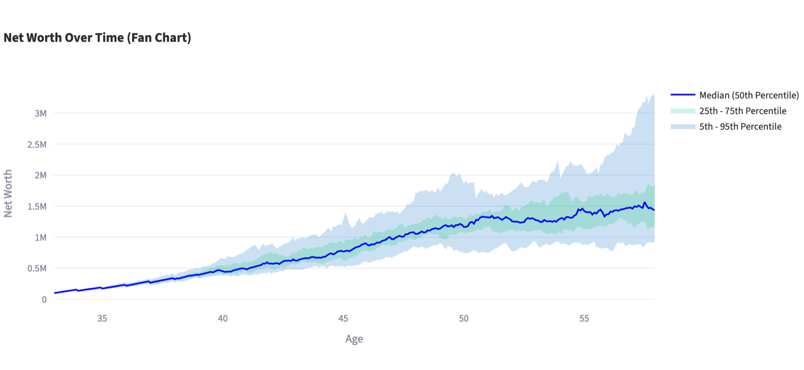
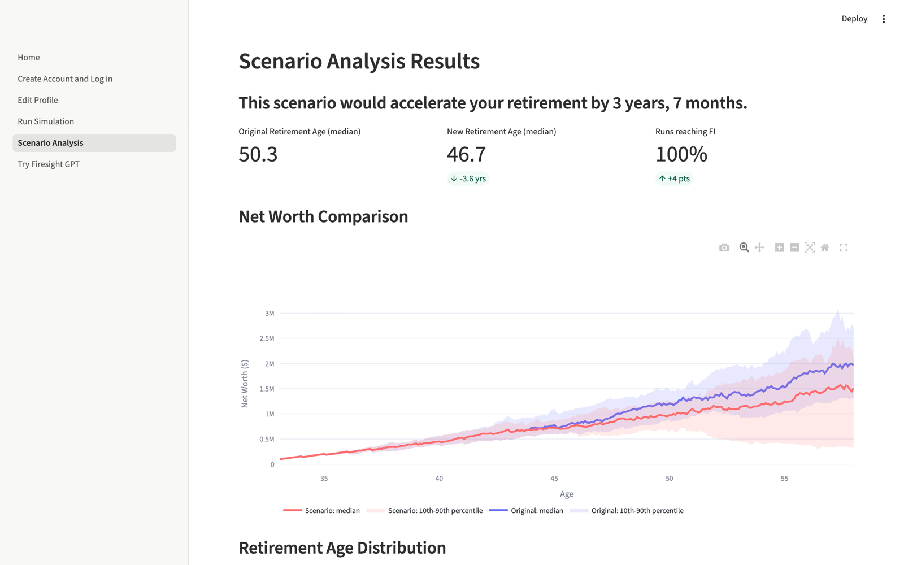
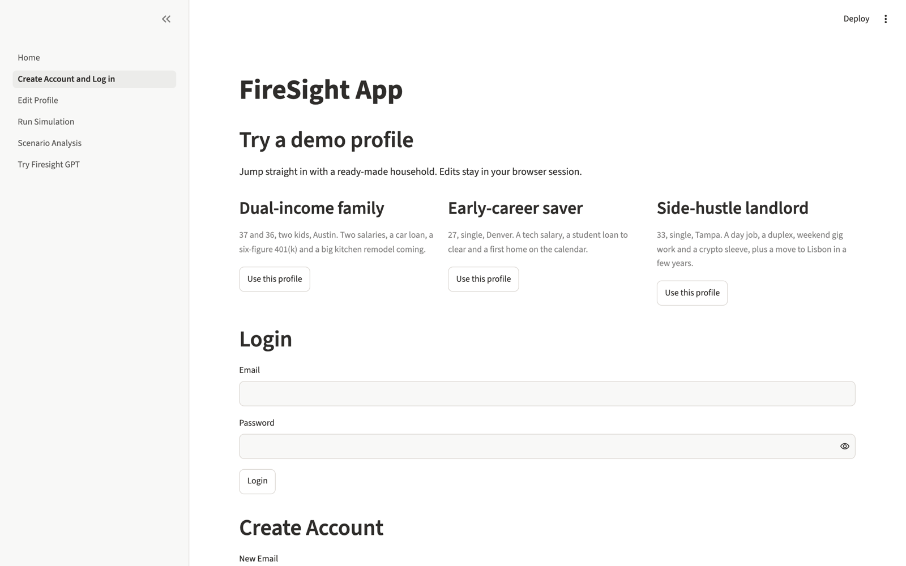
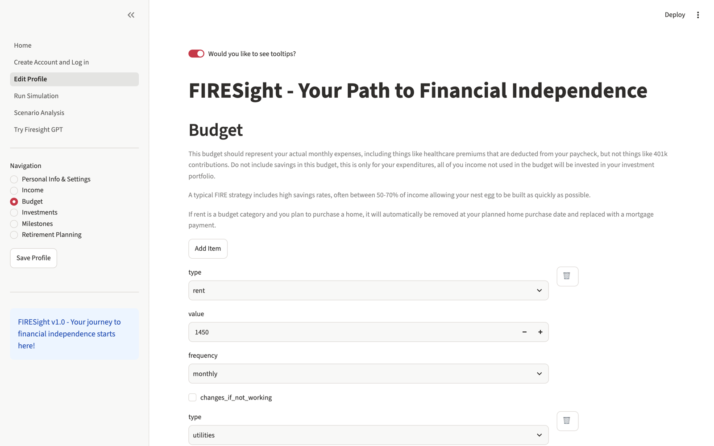

# 🔥 FIRESight

**A Monte Carlo early-retirement planner that lives out your financial life a month at a time, dozens of times over, and tells you when you can stop working.**

Most FIRE calculators take one number for "market return", multiply, and hand you a date. FIRESight models your whole financial life instead: every paycheck, bonus, rent check and gig, every budget line, loan and mortgage, taxes, the house you plan to buy, the move, the kid. It runs all of it against market histories rebuilt from 90+ years of real returns, so the answer comes back as a distribution: a median retirement age, a spread, and how many simulated futures actually get there.



## Features

- **Month-by-month household simulation.** Seven income types (salary with overtime, bonuses, commission, rentals, gig work, stock options with vesting and IPOs, assistance), a budget that inflates and can change once you stop working, amortized debts, leases, and an emergency-fund cash policy.
- **Life milestones.** Buy a house, finance a remodel, take a windfall, move cities (with a cost-of-living adjustment from a dataset of nearly 5,000 cities), get married, have a baby. Each one lands on the date you pick.
- **Realistic markets.** Stocks and real estate are block-bootstrapped from historical monthly returns, so crashes and recoveries keep their real shape. Bonds, crypto, P2P lending and the rest each get their own regime-switching model.
- **Real taxes.** Federal brackets, all 50 states' income-tax brackets, FICA with the wage base, and child tax credits.
- **Three ways to define "done":** the safe-withdrawal-rate target, a fixed number, or a stress test that drops your paycheck and checks your portfolio holds up across ten fresh 10-year futures.
- **Scenario analysis.** Change your income, budget, portfolio mix, retirement target or life events and see the effect side by side. Both plans run on the same random markets, so the difference is your decision and not luck.
- **FIRESight GPT.** Ask "what if I cut dining out in half and moved 10% into bonds?" in plain English. Claude calls the simulator and scenario engine as tools and answers with real numbers and charts.
- **Three demo households** (fabricated) to explore without typing in your own finances.

## Screenshots

| Scenario analysis | Demo profiles |
|---|---|
|  |  |

| Profile editor |
|---|
|  |

## Quickstart

Python 3.12 or newer.

```bash
git clone https://github.com/joey12725/firesight.git
cd firesight
python -m venv .venv && source .venv/bin/activate
pip install -r requirements.txt
streamlit run Home.py
```

Open http://localhost:8501, go to **Create Account and Log in** and pick a demo profile, then hit **Run Simulation**. Accounts you create are stored in `.firesight/users.json` on your machine.

To turn on FIRESight GPT, copy `.streamlit/secrets.example.toml` to `.streamlit/secrets.toml` and add an `ANTHROPIC_API_KEY` (or point it at Amazon Bedrock).

### Use the engine from Python

```python
import json

import scenarios

profile = json.load(open("examples/early-career-saver.json"))["profile"]

summary, runs = scenarios.run(profile, seed=7)
print(summary["median_retirement_age"], summary["success_rate"])

result = scenarios.compare(profile, {"income_multiplier": 1.15, "budget_changes": {"rent": 1200}}, seed=7)
print(result["baseline"]["median_retirement_age"], "->", result["scenario"]["median_retirement_age"])
```

## How it works

```
 profile (JSON)                       pages/ (Streamlit UI)
      │                     ┌──────────────────────────────────┐
      ▼                     │ Edit Profile · Run Simulation    │
 FIRE.User ──step_month()──▶│ Scenario Analysis · FIRESight GPT│
  income · budget · debts   └──────────────────────────────────┘
  milestones · taxes                 │            │
  portfolio ◀── ReturnGenerator      ▼            ▼
      │        (bootstrap /     scenarios.py   assistant.py
      ▼         Markov)         apply + compare  Claude tool loop
 run_monte_carlo_simulation()        │
      │                              ▼
      └──────────────▶ per-run time series, retirement ages, fan chart
```

Every simulated month: milestones fire, income and spending grow, paychecks land, bills and loans get paid, surplus cash is invested at your target mix, each asset class takes its own monthly return, and the model checks whether you've crossed your FI line. Taxes settle once a year. Repeat for every month of the horizon, then repeat the whole life once per simulation (25 by default, up to 200).

The full write-up, including the return models, the three retirement tests and how to extend the engine, is in **[docs/methodology.md](docs/methodology.md)**.

| File | What it does |
|---|---|
| `FIRE.py` | The simulation engine: `User`, income sources, budget, debts, homes, return generators, Monte Carlo runner |
| `scenarios.py` | Applies what-if changes to a profile and compares plans on a shared seed |
| `assistant.py` | FIRESight GPT: tool definitions and the Claude tool-use loop |
| `storage.py` | Accounts and profiles: local JSON store or DynamoDB, plus demo sessions |
| `pages/` | The Streamlit pages |
| `examples/` | Fabricated demo households |

## Configuration

Everything is optional. Set these in `.streamlit/secrets.toml` or as environment variables.

| Setting | Default | Purpose |
|---|---|---|
| `ANTHROPIC_API_KEY` | none | Turns on FIRESight GPT via the Claude API |
| `FIRESIGHT_LLM_PROVIDER` | `anthropic` | `bedrock` to use Claude on Amazon Bedrock with your AWS credentials |
| `FIRESIGHT_MODEL` | `claude-opus-5-5` | Model for FIRESight GPT |
| `FIRESIGHT_BACKEND` | `local` | `dynamodb` stores accounts in DynamoDB (picked automatically when AWS keys are set) |
| `FIRESIGHT_TABLE` / `FIRESIGHT_AWS_REGION` | `firesight-users` / `us-east-2` | DynamoDB table (partition key `userid`, GSI `email-index` on `email`) |
| `FIRESIGHT_SIGNUP_CODE` | none | Require an invite code to create an account |
| `FIRESIGHT_DATA` | `.firesight/users.json` | Location of the local account store |

## Deploying

The app runs as-is on [Streamlit Community Cloud](https://streamlit.io/cloud): point it at this repo with `Home.py` as the entry file and paste your secrets into the app settings. Use the DynamoDB backend there so accounts survive restarts.

## Development

```bash
pip install -r requirements-dev.txt
ruff check .
pytest -q
```

The tests cover the engine (amortization, federal and state tax brackets, bootstrap sampling, starting balances, each retirement test, seeded reproducibility), the scenario engine, password hashing and storage, the GPT tool loop with a scripted model, and smoke tests that drive every Streamlit page through `streamlit.testing`.

## Tech stack

Python · Streamlit · pandas · NumPy · Plotly · Claude (Anthropic API or Amazon Bedrock) · DynamoDB (optional)

---

Built by [Joey Hersh](https://github.com/joey12725). FIRESight is a planning toy, not financial advice.
